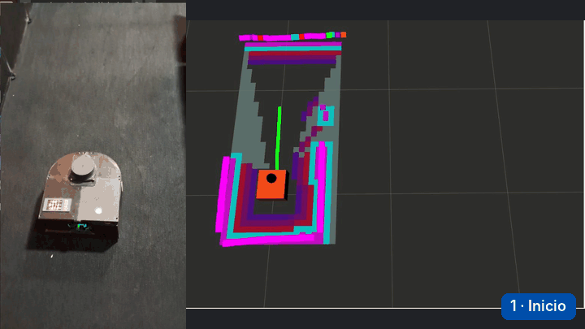

# Robot explorador

Guía abierta sobre el trabajo de titulación **"Navegación y exploración autónoma de interiores utilizando un robot móvil de tracción diferencial"**, de Sebastián Valderas Neculqueo, con el profesor guía Patricio Galarce Acevedo. Ingeniería Civil Electrónica, Universidad Tecnológica Metropolitana (UTEM), 2026.

**Estado académico: en revisión por comité. La tesis no está aprobada.** La guía sigue la versión de octubre de 2026 del documento. Las cifras pueden cambiar tras la revisión, sin que esta plataforma decida conclusiones académicas.

**Sitio:** https://svn11x.github.io/tesis_explain/



## Qué es

Un robot de bajo costo, con ROS 2, que entra a un recinto que no conoce, lo recorre solo y dibuja su plano. La guía explica cada parte del trabajo con la idea, la evidencia medida, los límites y casos del mundo real. Cada afirmación lleva su fuente numerada.

## Contenido

| Página | Tema |
|---|---|
| `index.html` | Portada, video, el ciclo en cuatro pasos con su simulación, temas, cifras, casos reales, una muestra de preguntas, rutas de lectura y el laboratorio |
| `problema.html` | Autonomía en interiores, estado del arte y un comparador que resalta por qué se descartó cada alternativa |
| `robot.html` | Piezas, energía, red, reparto entre Arduino, Raspberry Pi y computador, ROS 2 y costo |
| `movimiento.html` | Tracción diferencial y centro de giro, encoders, odometría, ensayos de recta y giro, qué corrige una calibración y el cuadrado en dos sentidos |
| `control.html` | El lazo de una rueda con sus unidades, PID en tiempo discreto, la ley heredada que opera como PI, windup, el modelo FOPDT, PSO y la estabilidad del lazo discreto con sus márgenes |
| `mapeo.html` | LiDAR 2D, rejilla de ocupación con área e índice, REP 103/105 y TF, ajuste de barridos con su curva de desacuerdo, grafo de poses, Ceres, capas de RViz, resultados de mapeo y comparación con el plano medido del recinto |
| `navegacion.html` | Mapas de costos, inflación, A estrella paso a paso, DWB y recuperaciones |
| `exploracion.html` | Exploración por fronteras y por qué 53 de 54 metas abortadas se asocian a reemplazos del propio explorador |
| `gemelo.html` | El modelo en Gazebo Classic y qué se compara con qué |
| `resultados.html` | Niveles de evidencia, los cuatro objetivos, intervalos de confianza y repeticiones, limitaciones y trabajo futuro |
| `replicar.html` | Materiales, conexiones, versiones, repositorios base y videos para aprender |
| `mundo-real.html` | Casos reales, de una aspiradora a la mina El Teniente y a Marte |
| `lecciones.html` | Lecciones de ingeniería que la tesis deja implícitas |
| `preguntas.html` | 106 preguntas difíciles en 15 temas y 3 niveles, con respuesta, repregunta probable, respaldo en la tesis y enlace al tema |
| `laboratorio.html` | Análisis local de CSV, de mapas de ocupación PGM y de registros de estados de metas, con métricas con fórmula, reglas transparentes, validación, procedencia y exportación JSON sin LLM |
| `recursos.html` | Glosario con filtro, presentación de la bibliografía con sus grupos, fuentes externas, materiales, cómo citar y créditos |
| `bibliografia.html` | Las 72 referencias de la tesis en 11 grupos, cada una con ficha, de qué trata, relación con la tesis, referencias relacionadas y cita para copiar, con filtro y descarga en BibTeX |

## Criterios del contenido

Las cifras y figuras del robot salen de la tesis y se citan con su sección, tabla o figura. Las fuentes externas se marcan por tipo y se reúnen en `recursos.html`. Los interactivos llevan la etiqueta **Datos de la tesis** cuando muestran mediciones, e **Interactivo** o **Ilustrativo** cuando usan datos de ejemplo, y lo que no se midió se dice de forma explícita.

## Estructura de archivos

```
├── *.html               páginas del sitio
├── css/estilo.css       diseño, tema claro y oscuro, movimiento, impresión
├── js/sitio.js          cabecera fija, menú, pie, índice lateral, buscador, citas, glosario, imágenes, videos
│                        y carga bajo demanda de los interactivos
├── js/decisiones.js     comparador de decisiones del tema 1
├── js/sims.js           simulaciones en canvas
├── js/vis1.js … vis3.js interactivos de cada tema
├── js/comun.js          utilidades compartidas
├── js/control-modelo.js cálculos verificables del capítulo de control
├── js/movimiento-modelo.js cálculos verificables del capítulo 3
├── js/movimiento.js     calibración de la recta y cuadrado en dos sentidos, en SVG
├── css/movimiento.css   estilos exclusivos del capítulo 3
├── js/mapeo.js          modelos y visualizaciones del capítulo 05
├── js/slam-proceso.js   candidatos de cierre y colas de procesamiento ilustrativas
├── css/mapeo.css        estilos exclusivos del capítulo 05
├── js/estabilidad-modelo.js análisis lineal del lazo de velocidad del Anexo 4.12, sin DOM
├── js/estadistica-modelo.js intervalos de confianza, Clopper y Pearson y prueba binomial, sin DOM
├── js/evidencia.js      interactivos de estabilidad, mapa frente al plano y repeticiones
├── css/evidencia.css    estilos de esos tres interactivos
├── js/analisis-modelo.js análisis de CSV y de registros de estados de metas, sin DOM
├── js/analisis-mapa.js  lectura de PGM y YAML, conteo de celdas y comparación de mapas, sin DOM
├── js/laboratorio.js    presentación del laboratorio
├── css/laboratorio.css  estilos exclusivos del laboratorio
├── js/preguntas.js      búsqueda, filtros, modo práctica y pregunta al azar de Preguntas difíciles
├── css/preguntas.css    estilos exclusivos de Preguntas difíciles
├── datos/indice.js      índice del buscador, generado
├── datos/academico.json estado académico, pendientes del autor e historial de cambios del sitio
├── datos/bibliografia.json referencias de la tesis: ficha, contenido, relación con la tesis, diferencias,
│                        código, referencias relacionadas, cita textual y dónde se citan
├── datos/bibliografia.bib la bibliografía en BibTeX para biblatex, generada desde el JSON
├── datos/parametros.json parámetros ya publicados en la guía, con su fuente
├── datos/proyecto.js    módulo generado desde los JSON y los CSV
├── datos/ensayos/       tablas de los ensayos en CSV, con su origen en la tesis
├── datos/analisis/      tablas que la tesis calcula sobre los ensayos: estabilidad, intervalos y plano
├── datos/ejemplos/      archivos SINTÉTICOS para probar el laboratorio, no son datos del robot
├── docs/                auditorías, informes, decisiones, trazabilidad y plantillas de revisión
├── herramientas/        generadores, índice del buscador y pruebas
├── fuentes/             tipografías locales con su licencia OFL
└── img/                 fotos, figuras de la tesis, animaciones y miniaturas
```

No hay dependencias ni paso de compilación.

## Capítulo 3: centro de giro, sesgo y calibración

`movimiento.html` explica la tracción diferencial con el centro de giro: el simulador dibuja ese punto, el círculo que seguirá el robot y el de cada rueda, y escribe las fórmulas con los valores de los deslizadores. Cuando el círculo cabe, el robot parte de modo que su centro de giro quede al medio del dibujo. La animación se pausa con un botón y espera a que la persona la inicie si el sistema pide reducir el movimiento.

El encoder compara la cuenta con los cuatro flancos de A y B con la cuenta que usa solo las subidas de A, para ver la multiplicación por cuatro paso a paso. La resolución de 0,11 mm por flanco sale de 2π · 33,5 mm / 1980.

El interactivo de calibración usa los errores de la Tabla A6.2 y separa sesgo, el error medio de 3,63 %, de dispersión, la desviación estándar de 0,44 %. Dividir por 1,0363 deja el error medio en cero y no quita la dispersión. Es un cálculo sobre los datos publicados: la tesis no aplicó esa corrección. El modo de simulación, rotulado como tal, prueba el factor en repeticiones nuevas.

El cuadrado en dos sentidos ilustra el método UMBmark de Borenstein y Feng con una diferencia entre ruedas y una separación efectiva distinta de la configurada. Muestra que los dos errores pueden compensarse en un sentido y sumarse en el otro. Es ilustrativo: el robot no se ensayó así. El caso de los conteos medidos, 1976 y 1969 flancos por vuelta, supone radios iguales.

`js/movimiento-modelo.js` reúne esos cálculos para los interactivos y las pruebas, y lee los mismos valores de `datos/ensayos/recta-2m-real.csv`, que las pruebas comparan.

## Capítulo 6: A estrella paso a paso

El interactivo de búsqueda guarda cada paso de Dijkstra y de A estrella. Se puede reproducir, pausar, avanzar de a uno o ir a cualquier paso con un deslizador. En cada paso muestra la celda que se revisa, el camino que la alcanzó (g), la estimación hasta la meta (h), f = g + h y las celdas pendientes. Las cuentas finales, 291 y 111 celdas para una ruta de 27 pasos, quedan siempre a la vista.

## Capítulo 4: control por ciclos y límites del firmware

`control.html` separa velocidad (m/s), conteo (ticks/ciclo), PWM e ITerm en la escala interna del numerador. Explica el error estacionario antes de usarlo, la diferencia entre 30 Hz nominales y el intervalo entero de 33 ms, y la separación entre tiempo continuo/discreto y forma posicional/incremental.

Los interactivos permiten aislar Kp, Kd y Ki, avanzar por ciclos, cancelar visualmente las diferencias de medición, distinguir el cambio de referencia del cambio de medición, inspeccionar truncamientos y comparar memoria y recuperación tras un bloqueo. El ejemplo de windup también permite proteger el integrador de un PI tradicional (PID con D=0 para aislar el fenómeno).

La comparación PSO/final muestra los seis pares de valores por rueda, con escalas explícitas e información sobre la validación. Los ejemplos de resolución separan el conteo del encoder, los dos decimales del registro y el promedio posterior. La recta está ensayada y el giro se identifica como estimación.

El simulador «Ajusta un PID» toma su modelo de `js/control-modelo.js` y agrega lecturas por regla. Cada lectura dice qué condición la activó y con qué cálculo se comprueba. Con solo P, por ejemplo, el error final coincide con referencia / (1 + K·P), y la lectura lo escribe con los números del gráfico. La figura de respaldo `img/diagramas/pid-respaldo.svg` se genera con el mismo modelo mediante `node herramientas/diagramas_control.js`, y una prueba compara sus cifras con el texto sin JavaScript.

El capítulo parte con un diagrama del lazo de una rueda que se recorre en cuatro etapas, medir, comparar, calcular y aplicar, con la unidad de cada señal: ticks/ciclo para lo pedido y lo medido, PWM para la orden y m/s para la rueda. El simulador PID deja la curva anterior en gris al cambiar las ganancias, para comparar error estacionario y sobreimpulso. El interactivo del modelo FOPDT dibuja las curvas de ambas ruedas con los parámetros de la Tabla A4.4 y marca dónde se leen la ganancia, la constante de tiempo y el retardo. Con PWM bajo advierte que el modelo no tiene zona muerta. El bloqueo dibuja cómo crece cada memoria y el windup informa cuánto sigue el motor en el tope después de liberar la rueda. El enjambre muestra la generación, el peso de inercia y la dispersión, con el eje vertical creciendo hacia arriba.

`js/control-modelo.js` reúne las ganancias y cálculos que usan los interactivos y las pruebas. Las simulaciones de bloqueo no son mediciones ni reproducen exactamente el encoder físico. El umbral de 60 PWM del ejemplo de zona muerta es supuesto y ajustable, no un valor medido del robot. Las ganancias y bandas adaptadas provienen de los datos ya publicados en la guía. El código adaptado no está disponible, mientras que el código base se enlaza como referencia independiente. Las consideraciones adicionales sobre conservar la ley se distinguen de los motivos documentados.

## Evidencia analítica: estabilidad, plano y repeticiones

La actualización del 26 de octubre de 2026 sigue la versión de octubre de 2026 de la tesis. Agrega tres secciones con su interactivo, sus tablas y su respaldo sin JavaScript.

- `control.html#estabilidad` explica el análisis del lazo discreto del Anexo 4.12, con la Tabla A4.5, los criterios de estabilidad, el barrido de 625 combinaciones, la banda en que la salida no cambia y la comparación entre las ganancias del PSO, las definitivas y las originales. El interactivo dibuja los polos y la curva de Nyquist de cada rueda y recalcula los márgenes al mover el retardo, la ganancia o la constante de tiempo de la planta. Cada cifra dice si es una fila de la tesis o un cálculo con el mismo modelo.
- `mapeo.html#exactitud` presenta la comparación de los cinco mapas con el plano medido con huincha, del Anexo 8.5, con el esquema del recinto, las once distancias de la Tabla A8.3 y la media y el percentil 95 por mapa en ambos sentidos.
- `resultados.html#confianza` presenta el alcance estadístico de la Sección 5.6 y del Anexo 8.6, con la Tabla A8.4, la prueba binomial exacta y el número de repeticiones que haría falta.

`js/estabilidad-modelo.js` es un port del análisis lineal de la tesis. `herramientas/pruebas_estabilidad.js` comprueba que reproduce cada fila de la Tabla A4.5 con el redondeo de la tesis, el barrido y las cifras del texto. `js/estadistica-modelo.js` calcula los intervalos, y `herramientas/pruebas_estadistica.js` recalcula la Tabla A8.4 con los valores por repetición de `datos/`. El esquema estático del plano, `img/diagramas/plano-recinto.svg`, se genera con `node herramientas/diagramas_plano.js` desde la misma geometría que usa el interactivo.

Los gráficos de todos los interactivos ahora se dibujan con el ancho real de su contenedor desde el primer montaje. Antes, los que medían su contenedor mientras se montaban leían un ancho de cero, se dibujaban a 600 px y en un teléfono quedaban reducidos.

## Cabecera fija y panel de Temas

La cabecera queda arriba al bajar por cualquier página. El elemento fijo es el contenedor `#cabecera`, porque un elemento `sticky` solo se queda pegado dentro de su padre. Al bajar se marca con una sombra y la barra de lectura corre por su borde inferior. Una franja azul y verde en el borde superior repite la del pie.

El panel de Temas cuelga de la cabecera completa y se centra en ella, con un ancho máximo de 1000 px y un alto que no supera la pantalla. Así no queda cortado aunque el botón esté lejos del borde o el navegador tenga zoom. Entre 861 y 1180 px, En el mundo real y Lecciones salen de la barra y quedan en la fila de complementos del panel. Bajo 861 px la navegación pasa al menú lateral. En un tema, el botón Temas se marca como sección actual.

## Preguntas difíciles

`preguntas.html` reúne 106 preguntas en 15 temas, cada una en un `details` con ancla `#p-…`, legible sin JavaScript. Cada respuesta se redacta de forma impersonal, con la repregunta más probable, la sección de la tesis que la respalda y el tema de la guía que la explica. El nivel va en `data-dificultad` (`general`, `tecnica` o `exigente`), no en `data-nivel`, que `js/sitio.js` reserva para la etiqueta de nivel de cada tema.

`js/preguntas.js` agrega la búsqueda, con la misma normalización del buscador del sitio, los filtros por tema y nivel, el modo práctica, que muestra primero un espacio para responder, y la pregunta al azar. Lo escrito en el modo práctica no se guarda. Los cinco temas agregados con la versión de octubre de 2026 cubren la estabilidad del control, la exactitud de los mapas, las repeticiones y la confianza, las fuentes citadas y la implementación descrita en los anexos. Los datos que solo el autor puede completar, como el método de medida del giro, conservan su comentario `PENDIENTE AUTOR` y un aviso visible, sin completar la respuesta. Un filtro de respaldo permite ver las respuestas con confirmación pendiente. El buscador del sitio indexa cada pregunta por separado.

## Bibliografía de la tesis

`bibliografia.html` reúne las 72 referencias de la tesis, numeradas como en ella y agrupadas en 11 grupos según la decisión que respaldan. Cada grupo explica en dos párrafos qué respalda y cómo se relacionan sus referencias, y su lista se abre con «Ver las N referencias». Cada referencia es un `details` con ancla `#r-…`: la línea visible dice número, autor, tipo y de qué trata en una frase, y al abrirla se lee en cinco bloques. La ficha va en dos columnas y en el teléfono pasa a una. De qué trata explica en varios párrafos el problema, el método, cómo lo evaluaron, sus resultados y sus límites. Relación con la tesis dice qué toma el trabajo, dónde aparece, en qué se diferencia y, cuando corresponde, dónde se aplica en el código del proyecto. Referencias relacionadas enlaza otras de la lista. Cita trae la cita textual, cuando la hay, y la cita como en la tesis, con botones para copiarla o copiar su entrada BibTeX. Los bloques largos muestran sus primeros párrafos y pliegan el resto con «Seguir leyendo».

Las afirmaciones salen del propio documento cuando el proyecto guarda una copia, y si no de su página oficial o su resumen publicado, revisados en octubre de 2026. La ficha dice de dónde sale cada detalle, y cuando una fuente no se pudo abrir lo declara y usa solo lo que dice la tesis. Las cifras que la tesis toma de una fuente se compararon con esa fuente.

`recursos.html#bibliografia` presenta la página, sus grupos y la descarga en BibTeX. Un script en la cabecera de `recursos.html` lleva los enlaces antiguos, `recursos.html#bibliografia`, `#bib-…` y `#r-…`, a la nueva página, y `js/sitio.js` hace lo mismo si el ancla cambia dentro de Recursos. Sin JavaScript se lee todo, cada grupo y cada referencia se abren a mano y el archivo `.bib` se descarga desde «Descargar y citar». Al imprimir se abre completa. El buscador tiene una entrada por referencia, con su resumen, los datos clave de la ficha y el detalle, y el filtro de la página busca en todo el texto de cada una.

La página pesa 111 KB comprimida. Lighthouse en teléfono, con un servidor local que comprime como GitHub Pages, le da 97 en rendimiento y 100 en accesibilidad, buenas prácticas y SEO, y axe no encuentra infracciones con todos los plegables abiertos. El índice del buscador, que se descarga solo al abrir la búsqueda, pasa de 141 a 209 KB comprimido.

## Cómo editar

1. **Temas.** La lista vive en `CAPS`, al inicio de `js/sitio.js`. Las páginas complementarias están en `EXTRAS`.
2. **Texto.** Cada página es HTML estático. Después de cambiar texto, regenera el buscador con `python3 herramientas/indice.py` (requiere `beautifulsoup4`) y sube `datos/indice.js` junto con las páginas.
3. **Citas.** `<a class="ref" href="#f3">3</a>` apunta a `<li id="f3">` en la lista de fuentes de la misma página.
4. **Glosario.** `<span class="term" data-def="Definición corta.">término</span>` muestra la definición al pasar el cursor, al enfocarlo o al tocarlo.
5. **Imágenes.** En `.webp` con respaldo `.jpg` o `.png`. Los gráficos van en WebP sin pérdida, que pesa menos que el PNG y conserva las líneas nítidas. Las fotos de cabecera tienen además una versión de 800 o 900 px en `srcset`. La versión grande va en `data-grande` y se abre con el botón Ampliar.
6. **Interactivos.** Un elemento con `data-vis="nombre"` se monta al acercarse a la pantalla con la función `window.VISUALES.nombre`. El archivo que la define se pide en ese momento: registra el nombre en `MODULOS`, al comienzo de los interactivos en `js/sitio.js`. Los modelos de cálculo, como `control-modelo.js` o `movimiento-modelo.js`, siguen en el HTML de su página porque esos archivos los leen al cargarse.
7. **Contenido pendiente.** Los bloques ocultos con `hidden` llevan un comentario `PENDIENTE AUTOR` que dice qué falta.
   Los videos preparados usan `data-src` y `data-poster`. Basta con agregar los archivos y quitar `hidden`.
8. **PDF de la tesis.** Solo cuando esté autorizado y disponible, registra una URL verificada en `tesis_pdf` de `datos/academico.json`.
9. **Estado y parámetros.** Edita `datos/academico.json`, `datos/parametros.json` y los CSV autorizados. Ejecuta `python3 herramientas/datos.py` y después `python3 herramientas/indice.py`. Actualiza el HTML relacionado. Los respaldos estáticos no se sustituyen por datos dinámicos. Consulta `datos/README.md` y `docs/trazabilidad.csv`.
10. **Bibliografía.** Cada referencia de la tesis vive en `datos/bibliografia.json`. Se ven sin abrirla su número en la tesis, su tipo, su autor y su línea de resumen, de hasta 80 caracteres. Al abrirla se leen su `ficha` (título original y en español, autores o editores escritos «Apellido, Nombre» o «=Institución», fecha, medio, volumen, número, páginas, edición, identificadores, enlaces, idioma, acceso, revisión de pares, versión consultada, palabras clave y de dónde sale el detalle), las `partes` que usa la tesis, de qué trata el documento (`contenido`, en párrafos), qué toma la tesis y para qué (`relacion`), en qué se diferencia el trabajo (`diferencia`), dónde se aplica en el código (`codigo`, opcional), las tablas o figuras donde aparece (`elementos`), las referencias relacionadas y una cita textual opcional de hasta 30 palabras con su página y su traducción. En los párrafos, `{r-id}` enlaza otra referencia. El campo `nota` del JSON describe el esquema completo. Después de editarla, ejecuta `python3 herramientas/datos.py` y luego `python3 herramientas/indice.py`. `herramientas/bibliografia.py` valida el archivo y escribe `bibliografia.html`, la presentación de la bibliografía en `recursos.html` y `datos/bibliografia.bib`. Se detiene si una referencia queda en dos grupos o en ninguno, si los números no van de 1 al total, si falta un dato obligatorio de la ficha, si una sección de la guía o una referencia enlazada no existe, si la explicación de una referencia no tiene entre 300 y 600 palabras, si un resumen pasa de 80 caracteres o si un texto usa punto y coma o guiones como separadores.
11. **Pendientes e historial.** Los pendientes del autor y el historial de cambios viven en `datos/academico.json`. `herramientas/datos.py` los escribe como HTML estático en `recursos.html#estado-academico`, entre los comentarios `ESTADO DETALLE`. Cada pendiente puede llevar un enlace a la pregunta o sección donde se nota.
12. **Tipografía.** Los anchos de lectura van en `em` y no en `ch`, porque el cero de Atkinson Hyperlegible es mucho más ancho que el de las fuentes del sistema. Las familias `Archivo Respaldo` y `Atkinson Respaldo` de `css/estilo.css` usan una fuente del sistema escalada para ocupar el mismo ancho mientras llegan las fuentes: Arial o sus equivalentes de igual ancho en Windows, macOS, iOS, ChromeOS y Linux, y las variantes `Roboto` y `DejaVu` en Android y en Linux sin Arial. Los títulos de los temas usan su propio respaldo, `--f-tema`, porque son cortos y el de la portada es largo. Si cambias una fuente, recalcula su `size-adjust`.
13. **Figuras y ejemplos generados.** `node herramientas/diagramas_control.js` regenera la figura de respaldo del PID, `node herramientas/diagramas_plano.js` el esquema del plano del recinto y `node herramientas/ejemplos_laboratorio.js` los archivos sintéticos del laboratorio. Con `--comprobar`, los dos últimos solo verifican que estén al día.

## Ver el sitio en tu computador

```bash
python3 -m http.server 8000
```

Luego abre http://localhost:8000

## Pruebas

```bash
node herramientas/pruebas_unitarias.js
node herramientas/pruebas_control.js
node herramientas/pruebas_mapeo.js
node herramientas/pruebas_slam_proceso.js
node herramientas/pruebas_movimiento.js
python3 herramientas/pruebas_control_navegador.py
python3 herramientas/pruebas_mapeo_navegador.py
python3 herramientas/pruebas_movimiento_navegador.py
node herramientas/pruebas_analisis.js
node herramientas/pruebas_estabilidad.js
node herramientas/pruebas_estadistica.js
python3 herramientas/verificar_sitio.py
python3 herramientas/pruebas_laboratorio_navegador.py
python3 herramientas/pruebas_robustez_navegador.py
python3 herramientas/pruebas_evidencia_navegador.py
python3 herramientas/pruebas_navegador.py
python3 herramientas/pruebas_experiencia_navegador.py
node herramientas/ejemplos_laboratorio.js --comprobar
node herramientas/diagramas_plano.js --comprobar
```

`pruebas_experiencia_navegador.py` comprueba lo agregado en la revisión de experiencia: con las fuentes 1,2 s tarde el CLS queda bajo 0,02, ninguna página carga los archivos de interactivos al abrirse, el video de la portada no se descarga junto con la página, los temas son filas compactas en un teléfono, el comparador de decisiones, el filtro del glosario, la bibliografía en su página, con el resumen y los cinco bloques de cada referencia, el plegado de los bloques largos, la ficha en una o dos columnas, los botones para copiar la cita y su BibTeX, el filtro, el teclado, la impresión y el traslado de los enlaces antiguos de Recursos, las secciones en el menú del teléfono, el movimiento reducido y el tema oscuro. También compara, entre 320 y 480 px, las líneas del título de cada tema con el respaldo y con Archivo. Si el sistema no tiene ninguna fuente de respaldo compatible, omite esas mediciones y lo avisa.

`pruebas_robustez_navegador.py` bloquea `datos/proyecto.js` y quita `MediaQueryList.addEventListener` para comprobar que la cabecera, el pie y los interactivos sigan funcionando. También recorre con teclado las tablas anchas en un teléfono, mide la altura del aviso académico en móvil, revisa las lecturas por regla del PID, el mapa armado del grafo de poses, las fichas del concepto y el estado académico sin JavaScript.

`pruebas_navegador.py` también comprueba que la cabecera quede fija al bajar, que el panel de Temas quepa en la pantalla entre 862 y 1920 px y que las herramientas de Preguntas difíciles funcionen con y sin JavaScript.

Las pruebas de Node revisan la geometría, el reloj y los casos numéricos de control. Las pruebas del capítulo 3 comprueban la cinemática y el centro de giro, la integración sobre arcos, los datos de la recta frente a su CSV, la calibración y el cuadrado en dos sentidos. Las pruebas unitarias incluyen además la búsqueda A estrella, con su h admisible. `pruebas_movimiento_navegador.py` recorre el capítulo 3 y A estrella en escritorio, móvil de 390 y 320 px, modo oscuro y movimiento reducido. Las pruebas de mapeo añaden oclusión y colisiones del LiDAR, celdas no observadas, el índice de cobertura, la curva de desacuerdo de los barridos, transformaciones SE(2) y optimización del grafo. `pruebas_control_navegador.py` inicia un servidor local temporal y comprueba los interactivos del capítulo 4 en escritorio, móvil de 390 y 320 px, modo oscuro y movimiento reducido. `pruebas_evidencia_navegador.py` recorre los interactivos de estabilidad, del plano y de las repeticiones en escritorio, en teléfonos de 390 y 320 px y en tema oscuro, y lee sus respaldos sin JavaScript. `pruebas_mapeo_navegador.py` hace lo mismo con los diez interactivos del capítulo 05: teclado, lecturas de área e índice, la cadena TF, la curva de los barridos, el desacuerdo del grafo y que los SVG en línea no traigan estilos. Requiere Playwright con Chromium instalado solo para desarrollo. `pruebas_navegador.py` usa Chromium con Playwright y recorre las páginas en escritorio, en teléfono y con movimiento reducido. Revisa errores, enlaces, anclas, el buscador, el glosario, los simuladores y el uso en teléfono.

## Capítulo 05: lo que mide cada interactivo

La ampliación del 22 de octubre de 2026 explica los cuatro componentes de SLAM por grafos, la selección y comprobación de candidatos, la covarianza y el costo ponderado. `js/slam-proceso.js` añade dos modelos locales: el selector con un pasillo compatible, otro parecido, una pose reciente y una lejana, y una comparación por eventos de colas síncronas y omisiones asíncronas. Ambos tienen controles por pasos, reinicio, respaldo sin JavaScript y supuestos explícitos. No ejecutan SLAM Toolbox ni usan registros experimentales. El grafo permite variar el peso del cierre manteniendo las mediciones, con los mismos resultados iniciales por defecto.

Se distinguen PGM/YAML y sesión serializada, mapeo, localización, continuación y lifelong mapping, con enlaces por minutos a ROSCon 2019. La tabla de parámetros separa lo declarado en la guía de los valores que no se publicaron: no copia valores predeterminados al prototipo. AMCL se presenta como una de las localizaciones posibles de un protocolo de metas fijas, junto con la de SLAM, y se precisan las descripciones de GMapping y del marco map en todas las páginas relacionadas. El estado académico y las tablas originales se conservan. Detalle y aplicación del parche en [docs/mejoras-slam-20261022.md](docs/mejoras-slam-20261022.md).

El LiDAR tiene leyenda, escala de 1 m y un robot que no se confunde con un botón. La rejilla calcula el área libre y el índice de cobertura con la misma fórmula de los resultados. La cadena TF se dibuja en el marco map: al aplicar map → odom se mueve el origen de odom y la flecha de las ruedas conserva su largo. El ajuste de barridos muestra la curva del desacuerdo total, con mínimo en 30 cm frente a los 40 cm que estiman las ruedas. El grafo de poses informa el desacuerdo en cada paso: 0 sin cierre, 29,3 al añadirlo y 0,18 después de optimizar. El ejemplo de cobertura conserva la celda ocupada en ambas imágenes y permite agrandar el margen desconocido para ver que el índice baja mientras el área no cambia.

Los SVG en línea no llevan estilos propios, para que no afecten al resto de la página ni al tema oscuro. Los archivos exportados a `img/diagramas/` sí los incluyen.

El grafo de poses también arma el mapa que forman las observaciones. Cada pose guarda lo que vio el láser en su propio marco, sin error en este ejemplo, y el mapa se dibuja donde dice la pose estimada. Antes del cierre, la pared vista al inicio y al regreso queda a 17,7 cm de sí misma. Después de optimizar coinciden, pero el mapa mide 2,15 m de ancho frente a 2,10 m del recinto del ejemplo: un mapa coherente puede conservar un error de escala. Es un recinto ilustrativo y no reemplaza una medición del prototipo.

Control, navegación y mapeo tienen una ficha del concepto plegable, con qué es, para qué sirve, cómo funciona, dónde verlo, un ejemplo numérico, cómo se usa en el robot y sus límites.

Los dibujos de respaldo del capítulo 05 se regeneran con `node herramientas/diagramas_mapeo.js`. Se guardan en `img/diagramas/` y permiten leer el capítulo sin JavaScript. Los modelos del capítulo están aislados en `js/mapeo.js`. No ejecutan SLAM Toolbox ni Ceres y no reemplazan las mediciones originales.

## Publicar en GitHub Pages

En Settings, Pages, elige "Deploy from a branch", rama `main` y carpeta `/ (root)`. Cada commit en `main` se publica en uno o dos minutos.

```bash
python3 herramientas/indice.py
git add -A
git commit -m "Describe el cambio"
git push origin main
```

## Experiencia y rendimiento

La revisión del 26 de octubre de 2026 conserva el HTML, CSS y JavaScript sin compilación y suma una identidad de plano técnico: la rejilla de ocupación detrás de los títulos, los anillos del LiDAR alrededor del prototipo, paneles azul noche y la franja azul y verde de la UTEM. La simulación del ciclo en la portada se dibuja como una consola azul noche, las imágenes de los temas comparten un tono azul que recupera su color al apuntarlas y en un teléfono cada tema es una fila compacta.

- **Sin saltos al cargar.** Las fuentes críticas se precargan y las de respaldo tienen métricas ajustadas, así el texto no se mueve cuando llegan. El CLS en teléfono, que iba de 0,14 a 0,33 según la página, quedó cerca de 0. Desde el 27 de octubre el respaldo también se ajusta a Roboto, de Android, y a DejaVu Sans, de Linux. Con solo Roboto instalada, el CLS en teléfono bajó de 0,145 a 0,0001.
- **Menos peso al abrir.** Los archivos de interactivos se piden al acercarse a la pantalla, los videos en bucle y la portada de un video lejano esperan a que el navegador quede libre y los gráficos pasaron a WebP sin pérdida.
- **Navegación.** Transición suave entre páginas con la cabecera fija, en navegadores que la soportan, y precarga de la página siguiente al apuntar un enlace. En un teléfono, el menú suma las secciones de la página que se lee.
- **Interactivos nuevos.** Comparador de decisiones en `problema.html#estado-del-arte`, filtro del glosario en `recursos.html#glosario` y bibliografía de la tesis, hoy en `bibliografia.html`, en grupos y con filtro, donde cada referencia es una línea de resumen que se abre con su detalle. El buscador del sitio lleva directo a cada referencia abierta.
- **Movimiento con propósito.** Las tarjetas aparecen con un leve ascenso al desplazarse y el barrido del LiDAR de la portada dura menos de 5 s. Con movimiento reducido no hay animaciones.

Lighthouse local, con compresión gzip como GitHub Pages: rendimiento de 78 a 94 antes y de 95 a 99 después en teléfono, 100 en escritorio, accesibilidad 100 y SEO 100 en las 16 páginas. El detalle está en `docs/informe-tecnico.md`.

## Accesibilidad

Se comprueban tema oscuro, movimiento reducido, navegación por teclado y respaldos. El menú móvil limita el foco y aísla el fondo, y el aviso académico y la navegación esencial funcionan sin JavaScript. Una tabla que no cabe en la pantalla se vuelve una región enfocable con nombre, para recorrerla con las flechas, y deja de serlo cuando vuelve a caber. Cada parte del arranque se inicia aislada: si una falla, las demás siguen. Las verificaciones automáticas y la revisión visual no son una certificación completa de WCAG 2.2 AA ni sustituyen pruebas con lectores de pantalla.

## Cómo citar

Valderas Neculqueo, S. (2026). *Navegación y exploración autónoma de interiores utilizando un robot móvil de tracción diferencial* [Trabajo de titulación en revisión por comité, versión de octubre de 2026]. Universidad Tecnológica Metropolitana.

El formato BibTeX está en `recursos.html#citar`.

## Licencia

El código del sitio, es decir `js/`, `css/`, `herramientas/` y la estructura de las páginas HTML, usa la licencia MIT del archivo `LICENSE`. Los textos, diagramas, fotos, figuras propias y las tablas de `datos/ensayos/` y `datos/analisis/` usan CC BY 4.0, como detalla `LICENSE-contenido.md`. Las imágenes de productos de terceros quedan fuera de esa licencia y las tipografías de `fuentes/` se rigen por la licencia OFL. Titular: Sebastián Valderas Neculqueo, 2026.

## Créditos de imágenes

Las fotos del prototipo, el recinto y las figuras técnicas son del autor y provienen de la tesis. Las imágenes de productos de terceros, como el RPLidar A1, el router GL.iNet, el Husky A300 y el LoCoBot, son de sus fabricantes y se usan para identificar los equipos. El detalle está en `recursos.html#creditos`.

## Laboratorio de análisis local

Elige una de las siete tablas ya disponibles o abre un CSV propio desde `laboratorio.html`. Se leen en memoria: no se suben, se guardan ni se procesan con IA. El análisis valida las columnas y unidades, distingue datos declarados de cálculos derivados y muestra condiciones y límites de cada regla. Se puede exportar JSON con procedencia, opciones y una huella local del texto UTF-8.

Las tablas actuales no permiten reconstruir trayectorias, rejillas ni el establecimiento del escalón. Un formato temporal opcional puede analizar registros propios, sin atribuirlos al robot.

También lee mapas de ocupación PGM, con su YAML si existe. Cuenta celdas libres, ocupadas y desconocidas con los umbrales de la tesis o los del YAML, calcula áreas y el índice de cobertura en la imagen completa y en el rectángulo observado, y compara dos mapas celda a celda solo si comparten tamaño, resolución y origen. Un registro de estados de metas, con una fila por meta en cada mensaje de estado, se clasifica por identificador como en el Anexo 8.4: completadas, abortadas asociadas a reemplazo, abortadas sin clasificar, canceladas y sin estado final. La asociación es temporal y no descarta fallas concurrentes. Los botones de ejemplo usan archivos sintéticos de `datos/ejemplos/`, rotulados como tales. Consulta `docs/laboratorio.md`. No se instalan modelos de IA ni servicios de inferencia.

## Documentación y revisión

- `docs/auditoria-inicial.md`, `docs/auditoria-e876140.md`, `docs/auditoria-b922205.md`, `docs/auditoria-a5bd066.md` y `docs/auditoria-ae42f52.md`: hallazgos y funcionalidades conservadas en cada revisión. La de b922205 contrasta el sitio con la versión de octubre de 2026 de la tesis, la de a5bd066 mide la experiencia y el rendimiento y la de ae42f52 revisa fallas y la bibliografía.
- `docs/informe-tecnico.md`: cambios, pruebas, uso y entrega de la revisión más reciente. Los informes anteriores están en `docs/historial/`.
- `docs/informe-academico.md`: integridad del contenido y asuntos que requieren confirmación.
- `docs/decisiones.md`: razones de arquitectura y límites de la evolución.
- `docs/mejoras-slam-20261022.md`: explicaciones de SLAM agregadas el 22 de octubre de 2026.
- `docs/trazabilidad.csv`, `docs/observaciones-comite.csv`, `docs/inventario-publicacion.csv`: fuentes, plantilla de observaciones reales y autorización de material.

`.github/workflows/verificar.yml` comprueba modelos, datos generados, enlaces y navegador en GitHub Actions al abrir un PR o actualizar main. Si una comprobación falla, su nombre aparece como anotación en el resumen de la ejecución, sin abrir el registro. Las dependencias de pruebas solo son para desarrollo. No se agregaron dependencias al sitio ni se publicó automáticamente la rama de trabajo.

Para aplicar un parche, parte de la revisión base indicada en el informe técnico, crea una rama independiente y ejecuta `git am` con el archivo del parche. Revisa el resultado antes de incorporar los cambios a main.
